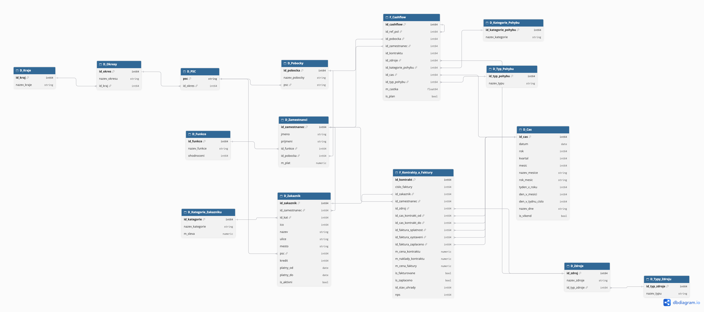

# Data Warehouse for a Construction Company: Medallion Architecture in BigQuery

A team semester project from a university data warehousing course. The task was to build a complete data solution for a fictional construction company, from raw CSV exports through a data warehouse to a Power BI report.

**My role:** design and implementation of all warehouse layers (Bronze, Silver, Gold) in pure SQL on BigQuery, plus validation of the data pipeline. The Power BI report was built by a teammate and is not part of this repository.

**Data:** the source data belongs to the course, so it is not published here. The repository contains only the SQL transformations. The scripts are readable, but they can't be run without the data.

**Language:** the case study was in Czech, so table names, column names, code comments and the column descriptions stored in BigQuery are in Czech.

This was my first project of this kind, built in about three weeks alongside a part-time job. The repository captures it as submitted. The last section covers what I would do differently today.

## Architecture


| Layer | Contents | Script |
|---|---|---|
| Bronze | Source CSVs loaded into BigQuery unchanged (27 tables) | loaded via BigQuery UI |
| Silver | Lookup tables, dimensions and two fact tables in a snowflake schema | `sql/02_silver.sql` |
| Gold | Denormalized dimensions and three data marts for reporting | `sql/03_gold.sql` |

### Silver (snowflake schema)


 
Diagram source: [`docs/silver_schema.dbml`](docs/silver_schema.dbml) (paste into [dbdiagram.io](https://dbdiagram.io) to view interactively).

- **Dimensions and lookups:** `D_Cas` (calendar 2014–2030), `D_Zakaznik` (customers), `D_Kategorie_Zakazniku` (customer categories), `D_Zamestnanci` (employees), `D_Funkce` (job roles), `D_Pobocky` (branches), `D_Zdroje` (resources: machines and work crews), `D_Typy_Zdroju` (resource types), geography `D_Kraje` → `D_Okresy` → `D_PSC` (regions → districts → postal codes), `D_Kategorie_Pohybu` (cash flow categories), `D_Typ_Pohybu` (income/expense)
- **Facts:** `F_Cashflow` (all cash movements, planned and actual), `F_Kontrakty_a_Faktury` (one row per contract)

### Gold (star schema)

- **Dimensions:** `D_Zakaznici`, `D_Pobocky`, `D_Zdroje`, `D_Zamestnanci`, denormalized with geography and lookups pulled directly into the dimension
- **Data marts:**
  - `F_Cashflow_Mart`: cash flows with precomputed plan/actual pairs for income, expenses and wages
  - `F_Kontrakty_Mart`: contract profitability, invoicing, payment behavior and customer satisfaction
  - `F_Cashflow_Odhad`: statistical estimate of a period missing from the source data (see below)

## Key Modeling Decisions

**Twelve cash flow source tables in one fact table.** The source had a separate table for plan and for actuals in each category (rent, wages, personal costs, overhead, resources, income). I merged them into `F_Cashflow` with an `is_plan` flag, a category and a movement type. The report works with a single table, and comparing plan to actuals is one filter.

**Contracts as a fact table with no fact-to-fact relationships.** Contracts, invoices and satisfaction ratings are joined into one table at contract grain. Dimension keys (customer, salesperson, resource, branch) are copied directly into the fact, so Power BI has no relationships between fact tables.

**Customers from three snapshots as one row with a validity period.** The source contained three states of the customer table taken at different dates. I originally planned full history tracking (SCD Type 2). Diagnostics showed that customer attributes never change between snapshots; only a customer's presence in a snapshot changes. The dimension therefore has one row per customer, with `platny_od` / `platny_do` (valid from / valid to) derived from the first and last appearance.

**A branch on every cash movement.** The source records the branch only for some movements. In `F_Cashflow_Mart` it is filled in from the employee (wages, personal costs) or from the contract's salesperson (income). Resource costs stay company-wide.

**Documentation inside the warehouse.** Every table and column has a description in `OPTIONS (description = ...)`, so the meaning of the data is visible without external documentation.

## Source Data Issues

A large part of the work was telling apart errors in the source from errors that would be in my pipeline.

- **Swapped invoice dates:** the issue date and due date columns were swapped in the source. Silver maps them in reverse on purpose, and the code comments explain why.
- **"NPS" that isn't NPS:** a column with this name holds a 0–10 satisfaction rating, not a Net Promoter Score. Gold adds a promoter / passive / detractor grouping from which NPS can be calculated.
- **Payment status with three values:** besides paid / unpaid there is "not applicable" (cancelled contract). A boolean flag would lose this, so the original status is kept as well.
- **Missing records in 2024:** actual cash flows for April to December 2024 are missing in the source, while plans and overhead are complete. Comparing Bronze to Gold month by month confirmed it was the state of the source, not a pipeline bug.

### Estimating the Missing Period

`F_Cashflow_Odhad` estimates the missing actuals as **plan × realization coefficient**. For each category, the coefficient is the average actual/plan ratio over the twelve months before the gap and the twelve months after it, excluding the ramp-up months right after the gap.

I backtested the method on the same months of 2022, where the data is complete. The error came out at −2.5 % for income, −0.2 % for expenses and −7.4 % for net cash flow. The estimate is usable at quarterly and annual level, but not for analyses where the argument would become circular. One example is wage spending against plan, since the estimate is derived from the plan. These limitations are written directly into the table description.

## Validation

I checked the pipeline with a set of validation queries:

- **Completeness:** row counts and amount totals in Bronze match Silver and Gold (cash flow, contracts, all dimensions)
- **Integrity:** primary key uniqueness and foreign key resolution (BigQuery keys are `NOT ENFORCED` only)
- **Logical consistency:** for example, no paid invoice without a payment date and no negative prices
- **End-to-end:** numbers in the Power BI report match direct queries against BigQuery

## What I Would Do Differently Today

I noticed these after submission. They don't change the results, but I would handle them differently now:

- **Type casting in Gold joins.** Silver is supposed to have unified types, yet Gold casts keys in its dimension joins (`CAST(... AS INT64)`). Types should be settled once, in Silver.
- **Mixed Slovak and Czech column names** (`kategoria_pohybu` next to `nazev_kraje`). A naming convention set from the start would have avoided this.
- **Inconsistent description of unpaid invoices.** Silver says `NULL`, Gold says `−1`. The code handles both, but the documentation should say one thing.
- **Hardcoded reference date** (`2026-08-31`) in the days-overdue calculation. It belongs in a parameter.
- **Small edge cases**, for example a contract with no price would fall into the "Large" size bucket.

## How It Was Built
 
Bronze was created by uploading the source CSVs into BigQuery unchanged. Silver and Gold are plain SQL scripts run in sequence: `sql/02_silver.sql` first, then `sql/03_gold.sql`. Within each file, tables are ordered by their dependencies.

## Structure
 
```
├── README.md
├── docs/
│   ├── silver_schema.dbml
│   └── silver_schema.png
└── sql/
    ├── 02_silver.sql
    └── 03_gold.sql
```